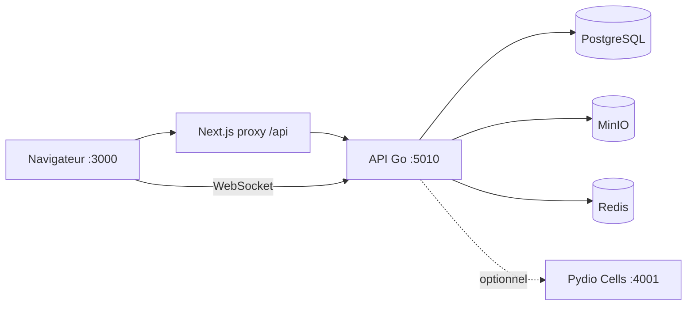

# ArchiFlow v3

GED et workflows d'approbation pour l'entreprise — backend **Go**, frontend **Next.js 14**, stockage **MinIO**, temps réel **WebSocket** + **Redis**.

---

## Fonctionnalités

| Domaine | Contenu |
|--------|---------|
| **Documents** | Dossiers, import, aperçu PDF/image, versioning, corbeille, recherche (FTS), favoris, verrouillage |
| **Workflows** | Validation 2 étapes (Responsable → Administrateur), approbations avec **aperçu + attestation** avant décision |
| **Collaboration** | Partages, commentaires, tags, notifications in-app + email (SMTP) |
| **Temps réel** | WebSocket `GET /api/ws` (défaut) ou SSE legacy ; broker Redis multi-instances |
| **Sessions** | Refresh opaque HttpOnly, rotation, révocation, idle timeout, plafond appareils |
| **Admin** | Utilisateurs, workflows, rôles (`admin`, `manager`, `validator`, `archivist`, `user`) |
| **ArchiFlow +** | Intégration Pydio Cells (profil Docker `cells`) — collaboration avancée, SSO |
| **Bureautique** | OnlyOffice (profil Docker `office`) — édition Word/Excel/PPT |
| **MFT** | SFTPGo (profil Docker `sftp`) — dépôt SFTP/FTPS → ingestion GED |

---

## Architecture



Le navigateur passe par le frontend (`/api/*` → backend). Les notifications utilisent `ws://host/api/ws` (ou WS direct via `NEXT_PUBLIC_API_URL` si le proxy Next ne fait pas l'upgrade).

---

## Prérequis

- **Docker** + **Docker Compose** v2
- Dev local optionnel : **Go 1.22+**, **Node.js 20+**

---

## Démarrage rapide

```bash
cd archiflow_v3
cp .env.example .env
docker compose up --build -d
```

Attendre que `postgres`, `minio`, `redis` et `backend` soient healthy, puis ouvrir **http://localhost:3000**.

### URLs

| Service | URL | Identifiants |
|---------|-----|--------------|
| Frontend | http://localhost:3000 | — |
| API Go | http://localhost:5010 | JWT / cookie refresh |
| MinIO API | http://localhost:9000 | `minioadmin` / `minioadmin123` |
| MinIO Console | http://localhost:9001 | idem |
| Redis | localhost:6379 | — |

### Compte seed (premier démarrage)

Un seul compte **superadmin** (`role=admin`) est créé au boot si aucun admin n’existe.

| Rôle | Email (défaut) | Mot de passe |
|------|----------------|--------------|
| Superadmin | `SEED_ADMIN_EMAIL` (déf. `admin@archiflow.local`) | `SEED_ADMIN_PASSWORD` (**obligatoire** dans `.env`) |

Les autres comptes (manager, validateur, archiviste, utilisateur) se créent depuis **Admin → Utilisateurs**.

Au premier login, le changement de mot de passe est forcé (`MustChangePassword`).

### Profils Docker optionnels

```bash
# Collaboration avancée (Pydio Cells + MySQL)
docker compose --profile cells up -d

# Édition bureautique OnlyOffice
docker compose --profile office up -d

# MFT SFTPGo (inbox SFTP → documents ArchiFlow)
docker compose --profile sftp up -d
# SFTP : localhost:2022 — Admin UI : http://localhost:8082
# Auth : email/password ArchiFlow via external auth hook
# Activer : SFTPGO_INTEGRATION_ENABLED=true dans .env
```

Cells : http://localhost:4001 — configurer `pydio_cells/.env` (voir commentaires en bas de `.env.example`).

### Commandes utiles

```bash
docker compose logs -f backend
docker compose logs -f frontend
docker compose down
docker compose down -v   # supprime les volumes (données)
```

### Test WebSocket notifications

```bash
node scripts/test-realtime-ws.mjs http://localhost:5010
```

---

## Développement local (hors Docker)

### Backend

```bash
cd backend
go mod download
# DATABASE_URL avec localhost:5432, MINIO_ENDPOINT=localhost:9000
go run cmd/api/main.go
```

API : http://localhost:5000 (ou `SERVER_PORT`).

### Frontend

```bash
cd frontend
npm install
# .env : INTERNAL_API_URL=http://localhost:5010
npm run dev
```

UI : http://localhost:3000 — le proxy Next redirige `/api/*` vers le backend.

---

## Configuration

Fichier unique **`.env`** à la racine (modèle : [`.env.example`](.env.example)).

| Variable | Rôle |
|----------|------|
| `DATABASE_URL` | PostgreSQL |
| `JWT_SECRET` / `JWT_REFRESH_SECRET` | Tokens (min. 32 car. en prod) |
| `JWT_SESSION_IDLE_MINUTES` | Expiration refresh si inactif |
| `JWT_MAX_SESSIONS_PER_USER` | Limite sessions par utilisateur |
| `REDIS_URL` | Pub/sub temps réel (`redis://redis:6379/0` en Docker) |
| `NEXT_PUBLIC_REALTIME_MODE` | `ws` (défaut) ou `sse` |
| `NEXT_PUBLIC_API_URL` | WS direct navigateur + build frontend Docker |
| `SMTP_*` | Emails (Brevo, etc.) — optionnel |
| `PYDIO_*` | Intégration Cells — voir `.env.example` |

Après modification de `NEXT_PUBLIC_*`, **rebuild** le frontend Docker :

```bash
docker compose build frontend && docker compose up -d frontend
```

---

## Authentification

- **Access token** JWT court (mémoire SPA, ~15 min)
- **Refresh token** opaque en cookie `HttpOnly`, rotation à chaque refresh
- Invalidation : logout, changement mot de passe, désactivation admin, dépassement idle / max sessions

| Endpoint | Description |
|----------|-------------|
| `POST /api/auth/login` | Connexion |
| `POST /api/auth/refresh` | Nouvel access token |
| `POST /api/auth/logout` | Révocation session |
| `GET /api/auth/me` | Profil (protégé) |

---

## Workflows

Workflow système **Validation Document** :

1. **Responsable** — rôles `manager`, `validator`, `admin`
2. **Administrateur** — rôle `admin`

Côté UI (**Workflows → Approbations**) : aperçu document, case d'attestation obligatoire, commentaire, puis Approuver / Rejeter.

API : `POST /api/workflows/validation/start`, `POST /api/workflows/instances/:id/approve|reject`, etc.

---

## Temps réel

| Canal | Usage |
|-------|--------|
| `POST /api/ws/ticket` | Ticket WS court (60 s) |
| `GET /api/ws?ticket=…` | Notifications + compteurs workflow (push) |
| `GET /api/notifications/stream` | Legacy SSE (poll DB) si `NEXT_PUBLIC_REALTIME_MODE=sse` |

Redis synchronise les événements entre plusieurs replicas backend.

---

## Structure du projet

```
archiflow_v3/
├── backend/                 # API Go (Echo, GORM)
│   ├── cmd/api/             # Point d'entrée
│   └── internal/
│       ├── handlers/        # HTTP
│       ├── services/        # Métier
│       ├── repository/      # Données
│       ├── realtime/        # Hub WS + broker Redis
│       └── models/
├── frontend/                # Next.js 14, Tailwind, Phosphor Icons
│   └── src/
│       ├── app/             # App Router
│       ├── components/      # UI (CRUD, workflows, dashboard)
│       ├── hooks/           # WS / SSE realtime
│       └── services/        # Client API
├── pydio_cells/             # Build Cells (profil cells)
├── scripts/                 # test-realtime-ws.mjs, smoke_e2e.sh
├── docker-compose.yml
└── .env.example
```

---

## Tests

```bash
# Backend
cd backend && go test ./...

# Frontend
cd frontend && npm test
cd frontend && npm run build

# Smoke E2E (stack Docker requise, mot de passe seed Admin1234!)
SMOKE_PASSWORD=Admin1234! ./scripts/smoke_e2e.sh

# WebSocket ticket + push
node scripts/test-realtime-ws.mjs

# Validation env production
./scripts/check-prod-env.sh

# Retest sécurité PT1–PT4 (API locale)
./scripts/pentest-retest.sh
```

---

## Production — checklist sécurité

Avant `ENVIRONMENT=production` :

| Variable | Exigence |
|----------|----------|
| `JWT_SECRET` / `JWT_REFRESH_SECRET` | ≥ 32 car., pas valeur `.env.example` |
| `PYDIO_API_TOKEN` | Token fort unique |
| `MINIO_ACCESS_KEY` / `MINIO_SECRET_KEY` | Pas `minioadmin` / `minioadmin123` |
| `COOKIE_SECURE` | `true` ou non défini (auto prod) |
| `AUTH_ALLOW_PUBLIC_REGISTER` | `false` (défaut prod) |
| `DATABASE_URL` | `sslmode=require` ou `verify-full` |
| `PYDIO_DEV_INSECURE` | **Non défini** (jamais en prod) |
| `NEXT_PUBLIC_REALTIME_MODE` | `ws` (pas `sse` en prod) |
| `PRESIGNED_URL_TTL_MINUTES` | `15` recommandé |

Script : `./scripts/check-prod-env.sh` (exécute les règles Go `ValidateSecurityForEnv`).

**WebSocket** : le client obtient un ticket court via `POST /api/ws/ticket` (auth JWT), puis `GET /api/ws?ticket=…`. Le JWT long n’apparaît plus dans l’URL.

**Pydio dev** : bypass auth API uniquement si `PYDIO_DEV_INSECURE=1` **et** `ENVIRONMENT≠production`. Remplacer l’ancien `PYDIO_SKIP_SIGNATURE_CHECK`.

**`pydio_cells/`** : dépôt vendored (~1 Go) pour le profil Docker `cells` ; en prod préférer l’image Cells officielle.

---

## Stack technique

**Backend** — Go 1.22, Echo, GORM, PostgreSQL, MinIO, Redis, gorilla/websocket, JWT, Zap

**Frontend** — Next.js 14, TypeScript, Tailwind CSS, Radix UI, Zustand, Axios, Geist

---

## Format API

Réponses JSON habituelles :

```json
{
  "success": true,
  "message": "Description",
  "data": {}
}
```

Erreurs : `success: false`, champ `error` ou `message`.

---

## Licence

Propriétaire — Landry D. / ArchiFlow.


